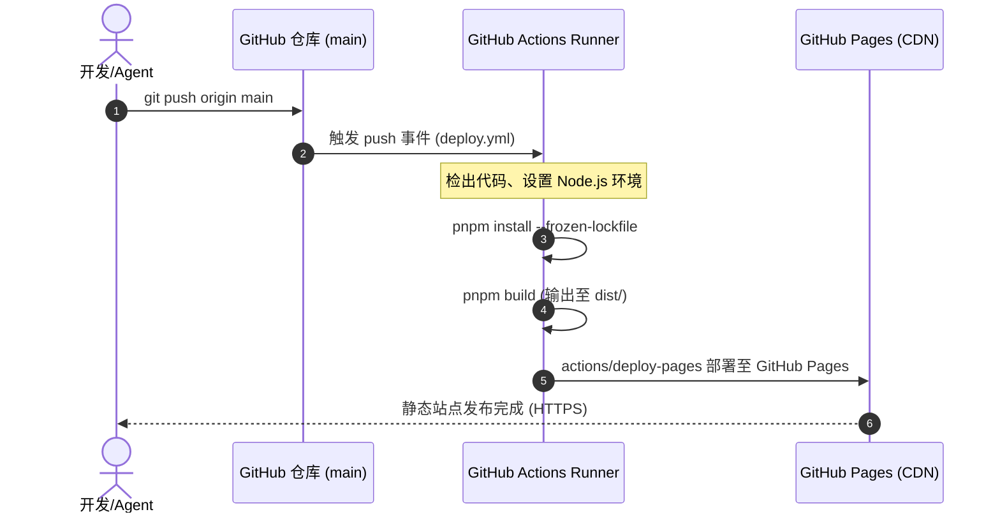

# 系统架构设计与部署说明 (Architecture & CI/CD)

## 1. 技术栈选型

- **核心框架**：[Astro](https://astro.build/) (v5/v6 最新静态站点生成模式)
  - **Zero-JS 默认理念**：文章正文及常规静态内容零客户端 JavaScript 开销，渲染性能极致。
  - **原生 CSS 与 CSS 变量**：直接采用现代 CSS 特性与原站精准 Design Tokens，避免 Tailwind 造成的预设样式污染，确保 1:1 像素级复刻。
  - **Vanilla 微交互**：沉浸式大纲（Immersive Outline）、等边三角形排序翻转、折叠代码块、外链自动 Favicon 等均采用纯原生轻量 JS 驱动，内聚在各 Astro 孤岛组件中。
- **运行与构建环境**：
  - 基于 NixOS 声明式环境，统一由 `nix-shell -p nodejs pnpm git` 提供底层支撑。

---

## 2. 工程目录拓扑

```text
/home/flynn/Documents/Blog/
├── .github/
│   └── workflows/
│       └── deploy.yml            # GitHub Pages 自动化 CI/CD 构建发布
├── docs/                         # 伴随式全量规范文档
│   ├── ARCHITECTURE.md           # 架构设计与部署说明
│   ├── DESIGN_TOKENS.md          # 逆向设计 Token 规范 (色板、字体、断点)
│   ├── COMPONENTS.md             # 核心组件结构与接口指南
│   ├── MAINTENANCE.md            # 日常博文撰写与扩展维护手册
│   └── EVIDENCE_LOG.md           # 限制项技术证据归档日志
├── public/                       # 静态资源 (Favicons、图标、图片素材)
│   ├── favicons/
│   │   └── external-links/       # 站外链接自动 favicon 本地缓存/默认项
│   └── favicon.png
├── src/
│   ├── components/               # 语义化组件
│   │   ├── common/               # SiteHeader, SiteFooter, SiteSettingsPanel
│   │   ├── blog/                 # BlogFilterBar, PostCard, TriangleSortButton
│   │   └── article/              # ImmersiveOutline, CodeBlock, ImageStack, Admonition
│   ├── content/                  # 内容集合 (Content Collections)
│   │   └── blog/                 # Markdown / MDX 博客文章源文件
│   ├── layouts/
│   │   ├── BaseLayout.astro      # 全局主容器、色彩系统注入、Header/Footer
│   │   └── PostLayout.astro      # 文章详情专用版心、大纲控制器、阅读进度
│   ├── pages/
│   │   ├── index.astro           # 首页 (Welcome & Recent Posts)
│   │   ├── blog/
│   │   │   ├── index.astro       # 博客列表展示页 (/blog/)
│   │   │   └── [slug].astro      # 动态文章详情页 (/blog/:slug)
│   │   └── rss.xml.ts            # RSS 订阅生成器
│   └── styles/
│       ├── global.css            # 全局重置、色彩变量、亮暗色定义
│       ├── typography.css        # Prose 排版样式、代码块与引用块
│       └── components.css        # 组件辅助样式
├── CHECKLIST.md                  # Feature 唯一真值三态追踪表
├── astro.config.mjs              # Astro 配置文件
├── package.json
└── tsconfig.json
```

---

## 3. GitHub Pages 自动化部署拓扑


