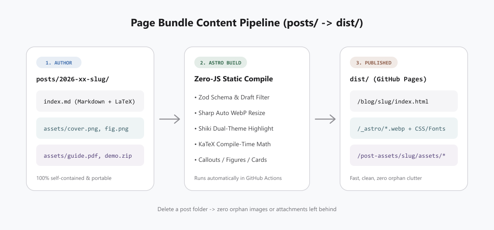
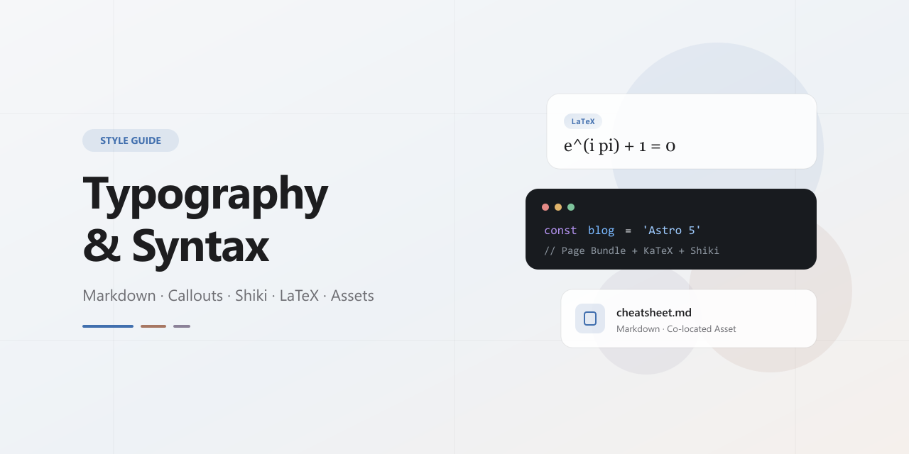

这是一篇**全特性活范例**，用来一次性核验并演示本博客支持的所有排版与写作语法。本文本身完全遵循「一文一盒（Page Bundle）」结构，所有配图与附件都存放在同目录的 `./assets/` 下，并且未手填 `words` 字段（顶部的字数由构建程序自动统计）。

> [!NOTE] 写作提示
> 日常写新文章无需在本地运行任何 `pnpm` 命令：直接把 `.md` 文件或包含 `index.md` + `assets/` 的文件夹放进 `posts/`，推送或通过 GitHub 网页上传到 `main` 分支，云端即自动完成图片压缩、公式编译与发布。

---

## 一、标题层级与行内文本样式

正文统一从二级标题 `##` 开始，一级标题 `#` 由页面模板专用于文章主标题。

### 三级标题示例：强调、代码与链接语义

常规段落支持 **加粗强调**、*斜体专有名词*、~~删除线文本~~，以及行内等宽代码如 `const site = 'f10w-0x00'` 或 `pnpm check`。

#### 四级标题示例：站内蓝链与站外棕链

本博客对超链接采用严格的莫兰迪色彩语义区分：
- **站内链接（莫兰迪蓝）**：例如查看这篇 [我是怎么使用 Obsidian 的](/blog/2026-10-01-how-i-use-obsidian/)，或浏览 [全部文档归档](/blog/)；
- **站外链接（莫兰迪棕 + 自动 Favicon）**：指向 [GitHub](https://github.com/F10w-0x00/F10w-0x00.github.io)、[Obsidian 官网](https://obsidian.md) 或 [维基百科](https://zh.wikipedia.org) 时，会自动在新标签页打开并附带本地高清 Favicon。

---

## 二、列表与常规引用块

### 无序与多级有序列表

- 无序列表第一项：适合罗列并列要点；
- 无序列表第二项：行距与段落留白保持自然呼吸感；
  - 嵌套子项：支持多层缩进。

1. 一级有序步骤：建立自包含文章文件夹；
   1. 二级字母步骤（自动切换为 `a.`）：放入 `index.md`；
      1. 三级罗马数字步骤（自动切换为 `i.`）：图片和附件直接丢进 `./assets/`；
      2. 校验相对路径写法；
   2. 推送到 GitHub `main` 分支；
2. 等待 GitHub Actions 自动编译上线。

### 常规引用块（带右上角引号装饰，全文完整展示）

> 好的个人博客架构应该像一本活页笔记本：每一篇文章带着自己的插图和附件独立成章，写的时候零摩擦，删的时候零残留，十年后依然清清爽爽、随时可读。
>
> 引用块现在默认完整展示，不再进行折叠截断，确保长段摘录也能保持顺畅的连续阅读体验。

---

## 三、五种 Callout 提示框

原生支持全部 5 种 GitHub / Obsidian Alert 提示框，浅色与深色模式均配齐莫兰迪低饱和度语义配色：

> [!NOTE] NOTE · 补充说明
> 适合放背景信息、更新日志或中性的延伸解释。

> [!TIP] TIP · 实用技巧
> 适合放最佳实践与效率建议，例如在 Obsidian / VS Code 中把默认贴图路径设为 `./assets`。

> [!IMPORTANT] IMPORTANT · 核心原则
> 适合强调不可忽略的关键前置条件或架构边界。

> [!WARNING] WARNING · 注意事项
> 适合提醒潜在坑点，例如单张原图过大时建议先适度压缩以保持 Git 仓库轻量。

> [!CAUTION] CAUTION · 危险操作预警
> 适合标注不可逆操作或安全风险，例如切勿将私钥或环境变量提交到公开仓库。

> [!NOTE CALLOUT-ICON-ONLY]
> 这是一个 **无标题纯图标提示框（`[!NOTE CALLOUT-ICON-ONLY]`）**，适合在行文中穿插一句简短的旁白或附言。

---

## 四、LaTeX 数学公式（KaTeX 编译期渲染）

数学公式在静态构建阶段直接由 `remark-math` + `rehype-katex` 预编译为纯 HTML，**零客户端 JS 开销**，深浅色模式自动适配。

### 行内公式

爱因斯坦质能方程 $E = mc^2$、欧拉恒等式 $e^{i\pi} + 1 = 0$，以及归并排序的时间复杂度 $\mathcal{O}(n \log n)$，都可以自然嵌入中文行文。

### 块级公式（自动居中，窄屏支持横向平滑滚动）

高斯积分与正态分布概率密度函数：

$$
\int_{-\infty}^{\infty} e^{-x^2}\,dx = \sqrt{\pi}, \qquad f(x) = \frac{1}{\sigma\sqrt{2\pi}} \exp\!\left(-\frac{(x - \mu)^2}{2\sigma^2}\right)
$$

多行对齐推导（`aligned` 环境）：

$$
\begin{aligned}
\nabla \cdot \mathbf{E} &= \frac{\rho}{\varepsilon_0} \\
\nabla \cdot \mathbf{B} &= 0 \\
\nabla \times \mathbf{E} &= -\frac{\partial \mathbf{B}}{\partial t} \\
\nabla \times \mathbf{B} &= \mu_0 \mathbf{J} + \mu_0 \varepsilon_0 \frac{\partial \mathbf{E}}{\partial t}
\end{aligned}
$$

矩阵与线性变换：

$$
R(\theta) = \begin{pmatrix}
\cos\theta & -\sin\theta \\
\sin\theta & \cos\theta
\end{pmatrix}, \qquad \det R(\theta) = \cos^2\theta + \sin^2\theta = 1
$$

---

## 五、代码块（Shiki 双主题高亮 + 一键复制）

代码块在浅色（GitHub Light）与深色（GitHub Dark）模式下均有完整语法高亮，左上角展示语言徽标，右上角提供一键复制按钮，**全文完整展示不折叠**。

```css
.file-asset-card {
  display: grid;
  grid-template-columns: 38px minmax(0, 1fr) 24px;
  align-items: center;
  gap: 14px;
  border-radius: 14px;
  background: var(--bg-soft);
}
```

```ts
// 超过 15 行的 TypeScript 示例（全文完整展示，不折叠）
export interface PostSummary {
  slug: string;
  title: string;
  date: Date;
  category: string;
  words: number;
}

export function formatReadingTime(words: number, wpm = 350): string {
  if (!Number.isFinite(words) || words <= 0) {
    return '1 分钟';
  }
  const minutes = Math.max(1, Math.round(words / wpm));
  return `${minutes} 分钟`;
}

export function groupPostsByYear(posts: PostSummary[]): Record<number, PostSummary[]> {
  return posts.reduce<Record<number, PostSummary[]>>((acc, post) => {
    const year = post.date.getUTCFullYear();
    (acc[year] ??= []).push(post);
    return acc;
  }, {});
}
```

```python
import math

def sigmoid(x: float) -> float:
    return 1.0 / (1.0 + math.exp(-x))

print([round(sigmoid(v), 4) for v in (-2, 0, 2)])
```

---

## 六、图片排版与居中图注

正文图片直接放在本文 `./assets/` 目录，构建时由 Sharp 自动压缩为 WebP，并按正文宽度自适应清晰展示（不再强行压扁为小缩略图）：



不写引号图注时，渲染为简洁的独立配图：



---

## 七、表格（GFM Tables）

宽表格在移动端（`<= 720px`）自动启用平滑横向滚动，不撑破页面版心：

| 功能模块 | 书写方式 | 渲染机制 | 客户端 JS 体积 |
| :--- | :--- | :---: | ---: |
| 常规文本与表格 | 标准 GFM Markdown | 静态编译 | 0 KB |
| 五种 Callout 提示框 | `> [!TIP]` 等 | Rehype 编译期改写 | 0 KB |
| LaTeX 数学公式 | `$...$` / `$$...$$` | KaTeX 编译期直出 | 0 KB |
| 代码语法高亮 | 三反引号 + 语言名 | Shiki 双主题静态输出 | 0 KB |
| 同目录图片优化 | `` | Astro Sharp 自动转 WebP | 0 KB |
| 极简附件下载卡片 | 单行 `[标题](./assets/a.pdf)` | Rehype + `post-attachments` | 0 KB |

---

## 八、极简文件下载卡片

将任意附件放入当前文章的 `./assets/` 目录，在 Markdown 中**独占一行**引用，即自动探测文件大小并生成极简圆角下载卡片（默认态右侧留白，悬停时浮现极简下载箭头，整卡可点击下载）：

[博客 Markdown 与 LaTeX 写作速查手册](./assets/blog-writing-cheatsheet.md)
